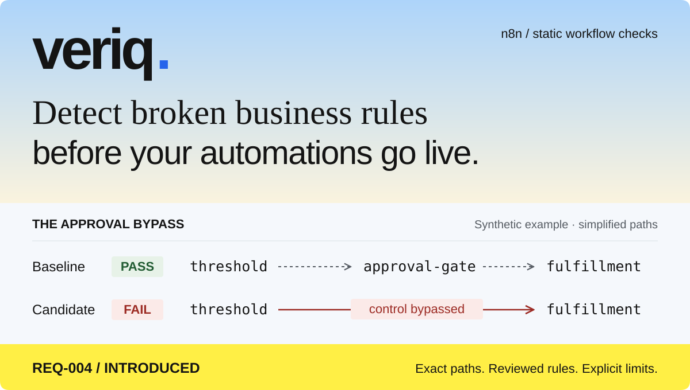

# Veriq

<p align="center">
  
</p>

**Check exported n8n workflows against reviewed business rules—without running them.** Veriq is a local Python CLI that compares workflow versions and produces JSON and Markdown reports with exact path evidence.

[Try the example](#quickstart) · [Supported semantics](docs/supported-n8n-semantics.md) · [Write rules](docs/rule-format.md) · [SOP & MCP guide](docs/sop-and-mcp.md)

> **Early preview.** Veriq checks a bounded static model with a narrow compatibility list. It does not prove live execution correctness, manager authorization, or regulatory compliance.

## One changed connection. One broken rule.

The [synthetic procurement SOP](examples/procurement-sop.md) requires high-value purchases to cross a reviewed blocking control. The [baseline](examples/purchase-v1.json) satisfies that rule. The [candidate](examples/purchase-v2.json) connects the threshold's true output directly to fulfillment, bypassing `approval-gate`.

The hero simplifies the baseline route: `threshold → review-request → approval-gate → approved-route → fulfillment`.

| Rule | Baseline | Candidate | Comparison |
|---|---|---|---|
| `REQ-004` · Required control | PASS | **FAIL** | **INTRODUCED** |
| `REQ-THRESHOLD` · Amount > PHP 10,000 | PASS | PASS | PERSISTING |
| `REQ-LOW` · Low-value route exclusion | PASS | PASS | PERSISTING |

Veriq identifies the counterexample:

```text
intake → intake-route → threshold → fulfillment
                       └─ true output bypasses approval-gate
```

The report includes node IDs, connections, and the condition's JSON pointer so a reviewer can trace the finding back to the export. This example contains synthetic data and does not implement a live approval or fulfillment service.

<a id="install-and-run"></a>

## Quickstart

Requires **Python 3.12+**. From the repository root:

```bash
python3 -m venv .venv
source .venv/bin/activate
python -m pip install -c constraints.txt -e '.[test]'
```

**1. Inspect the export.** The workflow is read as data, never executed.

```bash
veriq inspect --workflow examples/purchase-v1.json
```

**2. Verify the passing baseline.** Expected exit: **0**.

```bash
veriq verify \
  --workflow examples/purchase-v1.json \
  --rules examples/veriq.rules.yaml \
  --output-dir reports/baseline
```

**3. Catch the introduced bypass.** Expected exit: **1**.

```bash
veriq verify \
  --workflow examples/purchase-v2.json \
  --baseline examples/purchase-v1.json \
  --rules examples/veriq.rules.yaml \
  --output-dir reports/regression
```

Open `reports/regression/audit.md`, or retrieve the canonical evidence:

```bash
veriq explain --report reports/regression/audit.json --finding REQ-004
```

Core verification makes **no network requests** and needs **no model or API key** after installation.

## How the check works

1. **Import** an exported n8n workflow and a reviewed YAML policy.
2. **Verify** supported paths and conditions against the policy.
3. **Compare** candidate and baseline under the same rules to classify regressions.
4. **Review** exact evidence, unresolved coverage, and the resulting CI gate.

Three rule types cover the core checks:

| Rule type | Question it answers |
|---|---|
| `must_pass_through` | Must a route cross a specified control? |
| `forbid_path` | Can a prohibited route exist? |
| `require_condition` | Does a node retain the reviewed condition? |

Every enforced rule needs reviewer/date metadata. This records the review declaration; it is **not authenticated signoff**. Use your Git/team review process to supply genuinely approved policies. See the [example policy](examples/veriq.rules.yaml), [rule format](docs/rule-format.md), and [policy schema](docs/policy.schema.json).

## Know the boundary

Initial adapters accept **typeVersion 1 only** for Webhook, No Operation, IF, and webhook-resumed Wait without timeout. IF supports one literal numeric comparison or string equality/inequality, a constrained `$json.field` reference, and explicitly declared field types.

- Arbitrary expressions, Code nodes, unknown versions, disabled nodes, loops, and non-default error routing remain review-needed or unsupported.
- Declared fields are assumed present and correctly typed. A Wait proves a configured blocking waypoint; manager identity, authorization, connector internals, and live behavior need separate verification.
- Field identity after a Wait is unresolved for downstream conditions. Path exploration and evidence are bounded; a proven failure remains **FAIL** even when other paths are unknown.

Read the [supported n8n semantics](docs/supported-n8n-semantics.md) before applying a gate to your own exports.

## Use it in CI

The [workflow-check example](.github/workflows/veriq-example.yml) compares a candidate JSON export against the base revision's policy and baseline. It installs the verifier from the reviewed base; candidate program code is not installed or executed. **The base branch must already contain the verifier.**

The demo checks changes to `examples/purchase-v1.json`; `purchase-v2.json` is reserved for the local failure demo. Report artifacts are retained after a failed check. Protect workflow and policy review, and choose artifact access and retention for confidential data before adopting it.

| Exit | Meaning |
|---|---|
| **0** | No blocking proven violation; warnings or historical failures may remain |
| **1** | Introduced deterministic failure in comparison mode, or any proven failure in standalone mode |
| **2** | Invalid input/policy, engine error, or report write failure |
| **3** | Unresolved coverage with `--strict-unknown`, unless a blocking failure/error takes precedence |

Use `--fail-on-all-verified-failures` to block existing failures too. Without a baseline, regression classification is null. To evaluate a policy before enabling gates, `--warnings-only` keeps canonical verdicts and gate results while returning process exit 0 for finding-based outcomes; input/tool errors still return 2.

[Core CI](.github/workflows/ci.yml) targets Python 3.12 and 3.14. Actions use full commit pins and dependencies use [constraints.txt](constraints.txt). [Security scans](.github/workflows/security.yml) check Git history with Gitleaks and pinned dependencies with pip-audit; scanner errors and findings fail their jobs. See [publishing checks](docs/publishing-security.md) for pin details, scan scope, and pending networked validation.

## Beyond the CLI

**SOP authoring & local MCP.** Extract located PDF/DOCX text, draft source-backed requirements, review them explicitly, and trace approved rules to their source. Optional local Ollama assistance and a read-only MCP server are available. Drafts cannot enforce rules, and MCP cannot approve them.

```bash
python -m pip install -c constraints.txt -e '.[test,sop,mcp]'
```

Follow the [runnable SOP and MCP guide](docs/sop-and-mcp.md).

**Hosted deployment.** The OAuth-protected HTTP MCP service adds private expiring uploads and a plugin ZIP builder. The selected deployment uses Appwrite Cloud Functions, private Storage, transactional TablesDB quotas, scheduled expiry cleanup, and Clerk OAuth. The `/upload` page accepts workflow JSON, SOP PDF/DOCX, and reviewed YAML rules; sign in with the same Clerk account used in ChatGPT and pass the returned artifact IDs to Veriq.

[Appwrite deployment](docs/appwrite-deployment.md) · [Docker + HTTPS](docs/hosted-deployment.md) · [Browser upload setup](docs/hosted-deployment.md#browser-upload-page) · [Clerk configuration](docs/clerk-configuration.md)

[Production configuration and acceptance checks](docs/production-readiness.md) cover Clerk cutover, two-account verification, per-owner report retention, and the hosted parser subprocess boundary.

## Development & release status

Run the local suite after installing the test extra:

```bash
python -m pytest -q
```

The core includes bounded ingestion, strict policy validation, four pinned node adapters, three rule types, conservative path feasibility, validated evidence references, baseline comparison, stable finding fingerprints, CLI reports, synthetic fixtures, and CI definitions.

The [evaluation record](docs/evaluation.md) distinguishes measured local checks from pending validation. User interviews, pilot reviews, an independent held-out benchmark, and an actual GitHub-hosted CI run remain required before claiming the P0 release gate is complete. SOP/model validation also remains pending; a website/dashboard is later work.

<details>
<summary>Product and architecture context</summary>

[Product requirements](context/productRequirementDocument.md) · [Technical requirements](context/technicalRequirementDocument.md) · [App flow](context/appFlow.md) · [Data model](context/databaseSchema.md) · [Design brief](context/designBrief.md) · [Glossary](CONTEXT.md)

</details>
