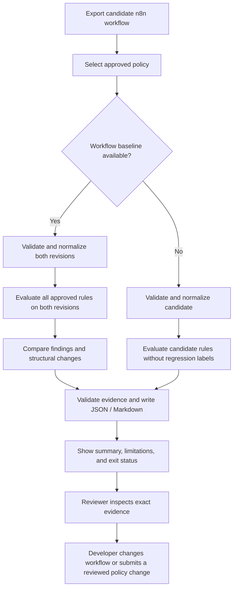
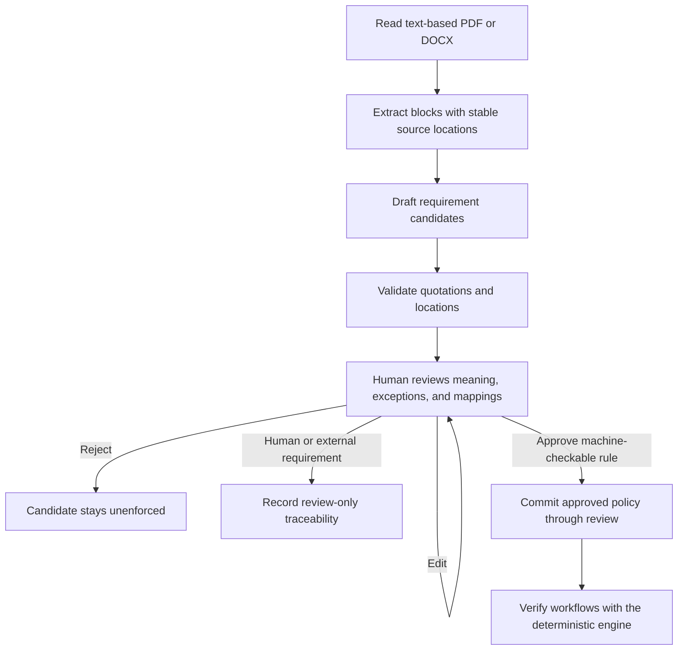

# Veriq — Application Flow

**Status:** P0 CLI journeys are implemented for the [declared subset](../docs/supported-n8n-semantics.md); P1 SOP/MCP journeys are implemented for local evaluation; see [the runnable guide](../docs/sop-and-mcp.md).  
**Source:** [veriq-plan.md](veriq-plan.md), sections 3–8 and 10–12.  
**Scope:** Local CLI → GitHub Actions → read-only local MCP. The future website in [designBrief.md](designBrief.md) is a separate delivery phase.

## Primary journey: check a workflow change



### 1. Prepare reviewed inputs

The developer exports workflow JSON and places it in their project. They select `veriq.rules.yaml` and, for a regression check, a reviewed workflow baseline. Baseline selection is explicit: Veriq does not silently treat whichever file is present as approved or passing.

The developer can first run:

```bash
veriq inspect --workflow examples/purchase-v2.json
```

Inspection reports the graph, supported node/version semantics, and unknown features. Unsupported behavior is visible before the developer relies on a verdict.

### 2. Run a comparison

```bash
veriq verify \
  --workflow examples/purchase-v2.json \
  --baseline examples/purchase-v1.json \
  --rules examples/veriq.rules.yaml \
  --output-dir reports/
```

These examples are runnable after the [repository installation](../README.md#install-and-run). The engine validates inputs and policy, constructs both graphs, and evaluates the same approved policy on both revisions. It records structural differences independently of finding classifications.

### 3. Read the result

The terminal summary shows evaluated rules, introduced failures, unresolved review items, report locations, and the gate outcome. `reports/audit.json` is the structured result; `reports/audit.md` is its readable rendering.

For the procurement example, a useful failure names `REQ-004`, shows baseline PASS and candidate FAIL, identifies the changed true-output edge, and reconstructs the supported path that bypasses the reviewed control. If the required field or branch semantics cannot be established, the result explains the uncertainty rather than inventing a counterexample.

```bash
veriq explain --report reports/audit.json --finding REQ-004
```

The explanation retrieves canonical evidence and limitations. It does not revise a verdict or approve a rule.

### 4. Review and rerun

The reviewer inspects the rule, node IDs, parameter references, branch outputs, and source citation when present. The developer fixes the workflow or proposes a deliberate policy revision through human review. After approval, both workflow revisions are evaluated under the same selected policy; the report identifies its policy hash so a changed policy cannot be mistaken for an unchanged verification basis.

Veriq never edits or deploys the workflow. External approval enforcement and runtime behavior remain manual/integration-test responsibilities.

## Standalone verification

```bash
veriq verify \
  --workflow examples/purchase-v2.json \
  --rules examples/veriq.rules.yaml \
  --output-dir reports/
```

No workflow baseline is required for a useful rule check. A proven failure returns exit code 1; findings have no regression classification, and the report states that change impact was not assessed. Unknowns warn by default or produce exit code 3 under strict-unknown policy. Input/configuration/engine errors return exit code 2.

## SOP-to-approved-rule journey — P1



1. Run `veriq rules draft --sop policy.pdf --output draft-requirements.json` command. Heuristics provide a model-free path; an optional local LLM can assist interpretation.
2. Show each candidate's exact quote, document revision, location, actor/action, conditions, exceptions, and proposed rule mapping.
3. Reject invalid citations before presenting a candidate as source-backed. Scanned documents require a text-based replacement; OCR is outside the release.
4. The reviewer edits, rejects, or approves the interpretation and maps it to stable workflow node IDs and declared fields. Unsupported human/external controls stay review-only.
5. Approved machine-checkable rules enter the version-controlled policy with reviewer/date metadata. Draft candidates are never enforcement inputs.
6. The traceability report connects source span → approved rule → workflow evidence → verdict and limitations.

The human review uses files and Git review. The flow does not imply a browser approval screen, account system, or authenticated signoff service.

## Pull-request journey — P0 after the evaluation gate

1. A pull request changes workflow data, policy, or the verification configuration.
2. GitHub Actions uses a reviewed verifier and explicitly selected candidate/baseline data. Untrusted workflow JSON is analyzed as data; attacker-supplied application code is not executed to inspect it.
3. The verifier generates the same JSON/Markdown evidence as the local CLI and applies the configured exit policy.
4. The job retains reports even when verification fails, subject to the repository's confidentiality/access policy.
5. The reviewer examines the artifact and addresses a proven regression or an explicit review item before deployment.

Warnings-only evaluation precedes blocking gates. Default comparison policy blocks introduced deterministic failures; strict unknowns and all verified failures are explicit policies. Existing defects remain visible even when the default comparison gate does not block them.

## Read-only MCP journey — P1

The user requests inspection, a comparison, a finding explanation, a report export, or draft requirements. The local MCP wrapper validates the request, calls the same engine, and returns structured results with evidence references. Conversation can explain those results but cannot override them or approve a proposed policy.

Implemented tools are `ingest_sop_document`, `ingest_n8n_workflow`, `verify_workflow_rules`, `compare_workflow_versions`, `get_audit_finding`, `export_audit_report`, and `draft_sop_requirements`. Remote upload/identity mechanisms are a later design; a ChatGPT attachment is not assumed to exist on the MCP server's filesystem.

## Outcome and recovery paths

| Situation | User sees | Next action |
|---|---|---|
| Invalid, oversized, or malformed input | Actionable validation error, exit 2 | Correct the export/configuration and rerun |
| Supported deterministic violation | FAIL, exact evidence, gate outcome | Fix workflow or submit a reviewed policy change |
| Proven violation plus other unknown paths | FAIL plus explicit incomplete-coverage warnings | Address the violation and separately review unknown behavior |
| Unresolved relevant semantics without a proven violation | NEEDS_REVIEW or UNSUPPORTED with reason | Review manually or use a supported configuration |
| Node renamed with stable ID | Informational structural change | No rule failure solely from the rename |
| Missing/changed node IDs | Review-needed identity mapping | Establish identity before claiming a resolved or introduced finding |
| Citation does not match source revision | Unresolved/rejected evidence | Supply the correct document or repair the mapping |
| Report cannot be written | Actionable output error, exit 2 | Select a writable location and rerun; no success claimed |

Exact gate precedence and the remaining implementation contracts are defined in [technicalRequirementDocument.md](technicalRequirementDocument.md).


## Hosted distribution — Phase 2

Configure Appwrite Functions and Clerk, then upload the selected workflow, reviewed policy and optional baseline/SOP through authenticated artifact endpoints. Pass returned artifact IDs to the same read-only MCP operations. The Functions adapter validates Clerk tokens and uses private Storage plus transactional TablesDB ownership/quota records. Reports persist across invocations; a separately scheduled function removes expired inputs/reports. Paths, URLs and another user's IDs are rejected. Approval remains in the local review process. The [Appwrite guide](../docs/appwrite-deployment.md) covers packaging, provisioning, deployment and remaining domain/Clerk configuration; the Docker deployment remains available.

The `/upload` browser page starts a Clerk authorization-code/PKCE login with `veriq:upload`, then offers workflow JSON, SOP PDF/DOCX and reviewed rules YAML uploads. It returns private artifact IDs with expiry and copy controls. Use the same Clerk user as the ChatGPT connection. The rules checkbox confirms an existing human review; it does not generate or approve rules. The upload session uses a Secure HttpOnly cookie, expires within one hour, and grants no cookie-based access to MCP. The file list stays only in the current page.
