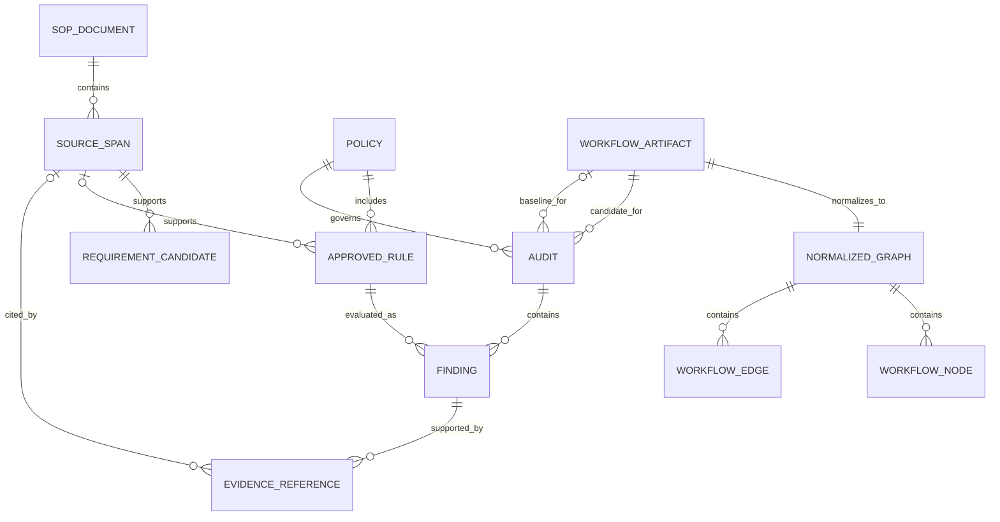

# Veriq — Artifact Data Model

**Status:** P0/P1 local file contracts are implemented. Appwrite Cloud persistence uses the private TablesDB and Storage definitions described below; it has not been provisioned live.  
**Source:** [veriq-plan.md](veriq-plan.md), sections 4–8.  
**Storage decision:** Files initially. This document keeps its existing `databaseSchema.md` filename while describing the actual initial storage model.

## Persistence boundary

Inputs are workflow JSON exports and optional SOP documents. The approved policy is `veriq.rules.yaml`; draft requirements are a separate JSON artifact. Verification emits `audit.json` and `audit.md`. Graphs and comparison data may live in memory and the audit; separate stored graph tables are unnecessary for the first release.

The source plan allows SQLite if a concrete review-history need emerges. There are no initial users, organizations, tenants, sessions, payments, or server-side approval tables. Shared hosting and authenticated review would require a separate model and authorization design.

## Entity relationships



These are logical relationships, not SQL tables. A workflow artifact can serve as a baseline in one audit and a candidate in another; that role belongs to the audit reference. A rule may be hand-authored without an SOP source.

## Identity and common conventions

- Hash raw file bytes using SHA-256; retain raw input identity separately from normalized semantic identity.
- A policy has human-readable `policy_id` and `policy_version`; its content hash identifies the exact reviewed artifact. Rule IDs are unique within a policy.
- Workflow node IDs are unique within a workflow revision. Node names are display metadata.
- Audit identity includes canonical input/policy/engine/adapter/configuration identities. Run timestamps are separate metadata.
- Finding fingerprints remain stable across equivalent results and exclude volatile timestamps and whole-workflow raw hashes. Exact serialization and transition matching must be frozen with fixtures.
- A local path is a location hint, not an immutable identity or an unrestricted remote access grant. Paths and original filenames are untrusted display/input data.
- Source location conventions use one-based PDF pages and DOCX paragraph indices. Text offsets, when stored, use zero-based Unicode character positions with an exclusive end and refer to a specified extracted block.

## Workflow artifact and normalized graph

| Entity / field | Type | Contract |
|---|---|---|
| Workflow `input_sha256` | string | Hash of exact imported bytes |
| Workflow `display_name` | string, optional | Sanitized descriptive filename; not identity |
| Workflow `normalized_graph_hash` | string | Hash under a recorded canonicalization version |
| Graph `canonicalization_version` | string | Defines normalization and serialization behavior |
| Graph `nodes` | list of nodes | Initial maximum 100 per workflow; unique IDs |
| Graph `edges` | list of edges | Directed typed connections with real endpoints |
| Graph `adapter_manifest` | versioned data | Exact supported types/versions used for interpretation |
| Graph `limitations` | list of structured reasons | Unknown features and relevant unsupported semantics |
| Node `id` | string | Stable workflow identity; mapping from export must be unambiguous |
| Node `name` | string | Original display name |
| Node `type`, `typeVersion` | export-compatible values | Preserved without silently coercing versions |
| Node `parameters` | JSON object | Untrusted configuration, never executed |
| Node `disabled` | boolean | Preserved state; semantics require an adapter contract |
| Edge `from`, `to` | node IDs | Both endpoints exist in the graph |
| Edge `output_index`, `input_index` | nonnegative integers | Preserve branch/input identity and ordering |
| Edge connection channel | string, when present | Preserve channel metadata; unsupported channels remain explicit |

Multiple connections between the same nodes must remain distinct when channel or indices differ. Node-only path lists are useful for display, but evidence must retain enough edge information to identify the actual route.

## SOP document and source span — P1

| Entity / field | Type | Contract |
|---|---|---|
| Document `document_hash` | string | SHA-256 of the source document bytes |
| Document format | PDF or DOCX | Text-based supported document |
| Document extraction identity | versioned data | Parser/version and relevant extraction configuration |
| Document blocks | ordered list | Exact extracted text with reproducible locations |
| Span document reference | document hash | Binds citation to a source revision |
| Span block reference | stable location within extraction | Cannot be an invented page/paragraph |
| Span `section` | string, optional | Heading/section label when available |
| Span `page` | integer, PDF only | One-based PDF page |
| Span paragraph index | integer, DOCX only | One-based index, with optional heading context |
| Span `quote` | string | Exact source text; validated against the identified extracted block |
| Span text offsets | start/end, optional | In bounds and matching the quote under the recorded extraction |

DOCX citations do not invent page numbers. Changing the document invalidates stale citation identity until references are revalidated. A display-redacted quotation is labeled separately from the source text used for citation validation.

## Requirement candidate — P1

Store draft candidates separately from approved policy. A candidate contains a local candidate ID, source-span reference, actor, action, trigger, condition, ordering, exceptions, proposed interpretation/mapping, and unresolved review questions. Preserve the original source even when the interpretation is edited.

Candidate IDs are local authoring references, not approved rule IDs. Candidate provenance may record heuristic/local-model generation, but that metadata provides no enforcement authority. The authoring flow can record edits or rejection; only explicit human review creates an approved rule in the policy.

## Policy and approved rule

The following fields derive from the plan's illustrative YAML contract. The complete type-specific grammar must be frozen before claiming runnable compatibility.

| Entity / field | Type | Contract |
|---|---|---|
| Policy `schema_version` | integer | Identifies the accepted policy grammar |
| Policy `policy_id` | string | Human-readable policy identity |
| Policy `policy_version` | version value | Explicit reviewed revision |
| Policy `fields` | field-to-type mapping | Declared numeric/string input assumptions for supported predicates |
| Policy `source_document` | object, optional | Source path hint and SHA-256 when SOP-derived |
| Policy `rules` | list of approved rules | Stable unique IDs; complete typed validation |
| Rule `id`, `title` | strings | Stable ID and readable label |
| Rule `type` | enum | `must_pass_through`, `forbid_path`, `require_condition` |
| Rule `severity` | enum | `low`, `medium`, `high`, `critical`; separate from verdict |
| Rule `source` | source citation, optional | Document-bound section/location/quote |
| Rule `scope` | typed object | Explicit workflow scope and node references appropriate to rule type |
| Rule `node_id`, `condition` | node ID and typed predicate | Required by `require_condition`, instead of path scope |
| Rule `applicable`, `not_applicable_reason` | boolean and optional text | A reviewed false applicability flag needs a reason and produces NOT_APPLICABLE |
| Rule `gate_node_id` | string, where required | Reviewed control identity for `must_pass_through` |
| Rule `when` | typed predicate, when supported | Declared field/operator/literal; unsupported predicates stay review-needed |
| Rule `approved.reviewer` | string | User-provided reviewer identity claim |
| Rule `approved.reviewed_on` | date | Recorded review date |

The policy content hash plus policy version identifies the approved rule revision in reports; no additional rule-version system is necessary for the initial contract. Source citations may be absent for hand-authored rules, but human approval is still required. Review metadata alone is not authenticated approval or a cryptographic signature.

## Audit and finding

| Entity / field | Type | Contract |
|---|---|---|
| Audit `schema_version` | integer | Versioned machine-readable report contract |
| Audit `audit_id` | string | Deterministic canonical verification identity |
| Audit `verifier_version` | string | Engine identity |
| Audit adapter/canonicalization identity | versioned data | Interpretation basis needed for reproduction |
| Audit `workflow_hash` | string | Candidate raw input hash |
| Audit `baseline_hash` | string or null | Null for standalone verification |
| Audit `policy_hash` | string | Exact enforced approved policy |
| Audit configuration | structured data | Effective scope, budgets, and policy settings |
| Audit run metadata | optional timestamp/display data | Excluded from semantic identity |
| Audit findings | list of findings | Canonical source for JSON and Markdown rendering |
| Audit gate outcome | exit/reason data | Uses the technical exit contract; not a global compliance claim |
| Finding `rule_id` | string | References a rule in the selected policy |
| Finding fingerprint | string | Stable semantic comparison identity |
| Finding `verdict` | enum | PASS / FAIL / NEEDS_REVIEW / UNSUPPORTED / NOT_APPLICABLE |
| Finding `regression` | enum or null | INTRODUCED / RESOLVED / PERSISTING / CHANGED / UNKNOWN_IMPACT; null without baseline |
| Finding `severity` | enum | Approved rule's impact severity |
| Finding `evidence` | structured references | Valid nodes, parameters, edges, paths, and optional source citations |
| Finding `limitations` | list of reasons | Includes incomplete coverage even when verdict is FAIL |
| Finding `review_required` | boolean | Human follow-up indicator, independent of verdict |

The standalone shape is intentionally explicit:

```json
{
  "baseline_hash": null,
  "rule_id": "REQ-004",
  "verdict": "FAIL",
  "regression": null,
  "severity": "high",
  "limitations": ["No runtime or external-service verification"],
  "review_required": true
}
```

This is a partial illustrative record, not a complete audit. A proven standalone failure blocks with exit 1; null regression means change impact was not assessed.

### Evidence references

Evidence binds node IDs and JSON pointers to the relevant workflow revision. Counterexample evidence includes ordered node IDs plus typed edges/output indices sufficient to reconstruct the route. Comparison evidence distinguishes baseline references from candidate references and identifies changed connections. SOP evidence binds the quote/location to the document hash.

The engine checks that cited nodes, parameters, edges, and source spans exist and support the claim. A missing reference cannot silently survive as valid evidence. Suggested tests and explanations remain separate from established evidence.

## Integrity, lifecycle, and retention

1. Validate inputs and typed references before verification. Preserve originals without modifying workflow exports or source documents.
2. Build graphs and findings in memory. Keep drafts outside the approved policy artifact.
3. Validate evidence against identified inputs; generate both report formats from one canonical audit.
4. Write complete reports without overwriting inputs or presenting stale artifacts as a new successful run.
5. Let the local user/repository control retention. There is no implied remote backup, hosted deletion policy, or automatic upload.

Reports can contain confidential procedure text and workflow details. Keep logs minimal, use synthetic public fixtures, and make artifact access/retention an explicit CI repository choice.

## Deferred schema work

The implemented policy contract is documented in [the rule format](../docs/rule-format.md) and [structural JSON schema](../docs/policy.schema.json), with additional engine validation for cross-field constraints. The [technical requirements](technicalRequirementDocument.md#decisions-required-before-implementation-is-considered-complete) track chosen P0 contracts and remaining validation. Introduce SQLite only when persistent history or queries justify it; P1 extraction contracts and budgets are documented in [the SOP guide](../docs/sop-and-mcp.md); a hosted multi-user schema remains separate work.


## Hosted artifacts — Phase 2

The Docker option uses a private file volume and an identity-scoped in-memory audit cache. The selected Appwrite Cloud option uses a private Storage bucket for validated input bytes and canonical audit JSON. Its private `objects` table records owner hash, external reference, kind/category, size, expiry and pending/ready state. Its `quotas` table stores per-owner/global file counts and byte reservations. Quota increments and object reservations commit together in a TablesDB transaction; blob upload is separate, with a pending state and scheduled recovery.

Both options derive owner identity from the verified Clerk issuer/subject and retain opaque input IDs and canonical audit IDs. Cloud report lookup is owner-scoped and survives cold starts. A separate scheduled function deletes expired blobs and transactionally releases counters. Client SDK access to the database, tables and bucket is disabled; the backend enforces ownership using its private runtime key. Exact schemas, quotas, expiry and failure boundaries are in [the Appwrite guide](../docs/appwrite-deployment.md) and [resource definitions](../deployment/appwrite/resources.json).
