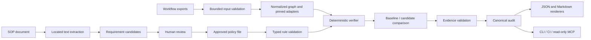

# Veriq — Technical Requirements

**Status:** P0 core implemented for controlled evaluation; [local evidence and remaining release gates](../docs/evaluation.md) distinguish tested behavior from pending validation. P1 local implementation is available; [the SOP/MCP guide](../docs/sop-and-mcp.md) records contracts, limits and remaining validation.  
**Source:** [veriq-plan.md](veriq-plan.md), version 2.0.  
**Confirmed clarifications, 2026-10-16:** CLI-first delivery; future website direction; standalone proven failures block with exit 1; a proven failure remains FAIL when other paths are unknown.

## Architecture and responsibility boundaries

Use one Python library for ingestion, graph normalization, rule evaluation, comparison, evidence, and reporting. The CLI and MCP adapters validate interface input and call that library; neither contains a separate verification implementation. SOP interpretation produces drafts and has no authority to grant verdicts or modify the enforced policy.

### Implementation stack

P0 uses the standard library where it fully serves the approved architecture. Exact tested dependency versions are recorded in [constraints.txt](../constraints.txt); optional SOP/MCP dependencies are installed through package extras; Ollama assistance uses the standard library.

| Concern | Planned choice | Boundary |
|---|---|---|
| Runtime | Python 3.12+ | Pin a supported development/CI environment before release |
| CLI | Standard-library argparse | Machine-readable output and documented exits; no decorative terminal dependency needed |
| Contracts | Pydantic | Strict workflow, rule, and report validation |
| Graph | Typed edge records and bounded standard-library traversal | Preserves parallel edges/indices and carries branch constraints without a separate graph dependency |
| Rule loading | PyYAML safe loader and typed DSL | No arbitrary object constructors or executable expressions |
| SOP text, P1 | PyMuPDF and python-docx | Located body text with budgets; OCR outside scope |
| Optional local AI, P1 | Opt-in loopback Ollama client | Simulated transport tested; real model quality/hardware validation pending |
| Persistence | Files | SQLite only after a concrete history/query need |
| Tests | pytest; optional hypothesis | Labeled synthetic fixtures, deterministic and adversarial cases |
| MCP, P1 | Official Python MCP SDK, stdio/Streamable HTTP | Local stdio and OAuth-protected hosted tools; public deployment/review remain pending |

The implementation keeps these responsibilities in `contracts.py`, `ingestion.py`, `semantics.py`, `verifier.py`, `reporting.py`, and `cli.py` under `src/veriq/`. P1 adds `sop.py`, `local_model.py`, `traceability.py`, and `mcp_server.py`. No separate web API, server database, or frontend is required for P0.

## Ingestion and compatibility

### Workflow JSON

- Accept one candidate export and optionally one baseline export. Enforce the initial 100-node maximum on each.
- Bound raw bytes, nesting, collection sizes, and work during ingestion, before unbounded allocation or graph construction. Numeric budgets must be selected and tested before the ingestion contract is considered complete.
- Validate workflow shape, unique stable node IDs, type/version metadata, parameter structure, and connection references. Duplicate/ambiguous identities and dangling references cannot silently become a valid graph.
- Preserve raw input SHA-256 separately from the normalized graph hash. Canonicalization may remove irrelevant object ordering but preserves output order, input indices, and semantically ordered values.
- Never execute imported Code nodes, templates, expressions, shell text, or connector requests. Never retrieve production credentials.

### Supported semantics

Publish fixtures and a manifest for the exact n8n node types and `typeVersion` values accepted. The initial set is simple linear nodes, trigger/terminal behavior, and explicitly supported IF variants with literal comparisons. The accepted versions are not specified by the source plan and must not be guessed.

Support only the declared numeric/text comparison grammar (`=`, `!=`, `>`, `>=`, `<`, `<=`) and tested field mappings. Do not infer arbitrary n8n expression semantics from a string that resembles a field reference. Value coercion, missing values, nulls, numeric representation, and string comparisons require an explicit tested contract.

`Switch`, loops, sub-workflows, arbitrary Code nodes, dynamic expressions, custom nodes, and unknown adapter versions remain unsupported or review-needed. A generic graph node does not establish its external behavior, data transformations, or approval enforcement. Relevant uncertainty propagates to affected rules; an unrelated unsupported node does not by itself negate a fully supported counterexample.

### SOP documents — P1

Read text-based PDF/DOCX without executing macros, following embedded links, or treating content as instructions. Preserve document hash, extraction version, exact text, and locations. PDF locations use pages; DOCX locations use headings and paragraph indices because reliable page numbers are unavailable from the initial parser approach.

The plan's initial document scope is approximately 30 pages. Enforce a 30-page PDF limit; define a corresponding DOCX text/paragraph and decompression budget before shipping that reader. DOCX must not falsely claim an exact rendered-page limit. Bound compressed/uncompressed input work and reject unsupported or unreadable content with an actionable error.

## Graph and verification contract

### Graph representation

Nodes retain stable ID, original name, type, type version, parameters, and disabled state. Connections retain source ID/output index and target ID/input index; preserve connection-channel metadata where present. Adapter-tested semantics determine branch meaning. Node names are display metadata, not control identities.

Track entries, reachable nodes, terminal nodes, and the rule's designated scope. Use bounded traversal with deterministic ordering and reconstructable edges. Cycles or exhausted budgets yield explicit coverage limitations; they cannot silently truncate an all-path PASS.

### Approved rule contract

The enforced file is a versioned policy containing stable rule IDs, type-specific scope, severity, reviewed mappings, and approval metadata. A source-document reference is optional for hand-authored rules. When present, its hash and citation must validate against the supplied source; unavailable or stale source evidence must be disclosed and cannot be represented as validated traceability.

| Rule type | Required invariant | Evidence |
|---|---|---|
| `must_pass_through` | Every applicable supported source-to-target route crosses the reviewed required control | Supported bypass path for FAIL; scope/coverage and control mapping for PASS |
| `forbid_path` | A route prohibited by the approved scope must be absent; any approved guard exception must be explicit | Supported prohibited route for FAIL; bounded reachability basis for PASS |
| `require_condition` | The designated supported condition matches the approved field/operator/literal constraint | Node ID, exact parameter pointers, expected and observed condition |

The plan's YAML is illustrative; the current version-1 contract is defined by [the rule format](../docs/rule-format.md), [structural schema](../docs/policy.schema.json), and engine cross-field validation. Only one supported `when` predicate is accepted. Missing targets/controls and zero applicable `must_pass_through` routes require review; explicit reviewed scope exclusions produce NOT_APPLICABLE.

A claimed counterexample must be feasible under supported branch conditions, not merely connected in the raw graph. If feasibility or a control's relevant behavior depends on unknown semantics, classify that uncertainty instead of treating raw reachability as a proven violation.

### Verdict and coverage contract

- `FAIL`: at least one independently supported counterexample or configuration contradiction establishes a violation.
- `PASS`: all applicable obligations are established within the declared model; no relevant unresolved uncertainty remains.
- `NEEDS_REVIEW`: unresolved semantics, mapping, interpretation, or coverage prevent a supported conclusion.
- `UNSUPPORTED`: the rule or feature has no declared verification capability.
- `NOT_APPLICABLE`: explicit scope establishes that the requirement does not apply.

**A supported violation takes precedence over other unknown paths for that rule.** Preserve FAIL, retain incomplete-coverage details, and avoid implying that every possible violation was found. Unknown behavior cannot be used as the proof of failure. Aggregate rule verdicts never erase rule-level reasons or limitations.

## Comparison and reproducibility

1. Normalize and hash both revisions; record engine, canonicalization, adapter, policy, and effective configuration identities.
2. Match nodes by stable ID. A name-only change is informational. Changed IDs require review-needed matching rather than confident heuristic equivalence.
3. Identify structural additions/removals, rewiring, parameter changes, type/version changes, and renames.
4. Evaluate every approved rule on both workflows under the same selected policy. If the policy was deliberately revised, identify that new basis explicitly; do not describe a result as an unchanged-policy comparison.
5. Compare verdicts and stable finding fingerprints. Emit `INTRODUCED`, `RESOLVED`, `PERSISTING`, `CHANGED`, or `UNKNOWN_IMPACT`; uncertainty that prevents a reliable comparison must remain visible.

A change from FAIL to unknown is not a proven resolution. A change from unknown to FAIL does not automatically prove that a new violation was introduced. Define the complete transition/fingerprint table with fixtures before enabling comparison gates.

The audit identity hashes canonical input identities, policy, engine/adapter versions, and effective verification configuration. Exclude timestamps, absolute working paths, terminal presentation, and node display names from semantic comparison identity where they do not affect behavior. Raw byte hashes still change when raw files change.

Finding fingerprints identify a rule and canonical semantic evidence across runs; they must not include the entire workflow byte hash or display timestamps, which would make every edit appear new. Freeze fingerprint serialization and deterministic witness selection with the comparison fixtures. JSON and Markdown derive from the same audit object.

## Evidence and reporting

Every finding identifies its rule and policy version/hash, verdict, severity, and limitations. A deterministic failure supplies real node IDs, valid JSON pointers, typed edge references, and a minimal supported counterexample when the rule is path-based. Traceability adds the matching SOP hash, location, and validated quote when applicable.

Validate references before publishing them as evidence. Missing or stale evidence cannot support a definitive claim; an internal contradiction between verifier output and available evidence is an engine error. Report generation failure is a tool error, not successful verification.

Write `audit.json` and `audit.md` to the requested output directory. Use complete-file replacement so a failed write does not leave a truncated report presented as complete, and avoid overwriting input files. Do not silently reuse old reports after a failed run. The user-facing report contains:

1. Scope, limitations, gate result, and rule counts.
2. Input/policy hashes and engine/adapter versions.
3. Structural differences and finding classifications when a baseline exists.
4. Source → rule → evidence → verdict traceability.
5. Counterexample paths, parameter evidence, and unresolved coverage.
6. Suggested reviewer actions and tests, clearly separate from verified facts.

## CLI and exit contract

Implemented P0 commands are `inspect`, `verify`, and `explain`; examples and journeys are in [appFlow.md](appFlow.md). They work offline with hand-authored rules and no model credentials. `rules draft`, `rules approve`, source-aware `verify --sop`, and `mcp --root` provide the P1 authoring and integration flows.

| Exit | Meaning |
|---|---|
| `0` | No blocking proven violation under the selected policy; nonblocking unknowns or historical defects may remain |
| `1` | A blocking deterministic failure: introduced failures in default comparison mode; any verified failure in standalone mode or with `--fail-on-all-verified-failures` |
| `2` | Input/configuration error, internal engine error, or inability to produce the requested result/artifacts |
| `3` | An unresolved/unsupported result is blocking under `--strict-unknown`, with no higher-precedence error/failure |

Precedence is **2 → 1 → 3 → 0**. An error prevents a normal successful result; a known blocking failure remains failure even when unknowns coexist. The machine-readable audit also records reasons so an exit code is never the entire result.

Without a baseline, use `baseline_hash: null` and `regression: null`; do not fabricate `INTRODUCED`. In comparison mode, `PERSISTING` failures do not block by default, but remain visible. Strict-unknown policy is opt-in. Blocking gates are enabled only after the supported fixture/evaluation gate passes; warnings-only rollout does not rewrite FAIL as PASS.

## CI and MCP integration

GitHub Actions runs a reviewed/pinned verifier with least-privilege repository access. Analyze PR workflow data without running attacker-supplied program code; keep secrets out of untrusted runs. Retain appropriate reports even on failure, and use synthetic examples in public artifacts. Exact action/package versions must be checked during implementation; the source plan's package-install snippet is a placeholder.

The later local MCP wrapper exposes inspection, verification, comparison, finding retrieval, report export, and optional requirement drafts. It preserves canonical tool verdicts and has no approval, workflow-edit, execution, or deployment tool. A remote deployment needs separately designed authentication and artifact ingestion; arbitrary client paths and automatic access to chat attachments are not acceptable assumptions.

## Security and privacy requirements

- Treat JSON, YAML, document prose, filenames, and model output as untrusted data. Preserve bounded parsing and safe deserialization at every input boundary.
- Keep source files local by default. External AI transmission requires explicit authorization; optional extraction is separately configured from deterministic checks.
- Keep sensitive values out of logs, demo fixtures, and public artifacts. Redacted displays must be labeled and must not be misrepresented as exact unmodified quotes.
- Escape report content and terminal control characters appropriately. A Markdown report must not turn imported text into executable HTML or misleading active content.
- Restrict file access to intentionally supplied local inputs and output locations. Read-only MCP does not imply unrestricted filesystem access.
- Record policy identity and reviewer claims without claiming authenticated or cryptographic signoff. New remote/shared storage requires an authorization and isolation design.

## Verification gate

The required cases and release targets are in [the PRD](productRequirementDocument.md#validation-and-release-criteria) and source plan section 12. Cover supported semantics, bypasses, thresholds, reversed outputs, unreachable/disabled controls, node renames, ID changes, dynamic/unsupported features, traversal limits, invalid inputs, prompt injection, fake citations, standalone exits, and mixed proven-failure/unknown results.

All 173 combined core/SOP/hosted local tests pass on Python 3.12.14 and 3.14.7, covering deterministic repeatability, fixture reference validity, safe ingestion, CLI exits, and reports; the [evaluation record](../docs/evaluation.md) states their scope. GitHub-hosted artifact retention, independent n8n execution compatibility, and pilot reviews still need validation. Evaluate P1 extraction quality independently from graph verification.

## Decisions required before implementation is considered complete

The P0 choices below now have executable contracts and fixtures. Remaining external validation is tracked separately from P1 implementation.

| Contract to freeze | Completion evidence |
|---|---|
| Exact P0 node types/versions, channels, disabled-node behavior | [Pinned compatibility contract](../docs/supported-n8n-semantics.md) and 32 labeled workflow cases; independent n8n validation pending |
| P0 byte/depth/item/state/output budgets | Published numeric bounds and boundary tests; broader capacity measurements pending; DOCX budgets are published in the SOP/MCP guide |
| Rule grammar, applicability, missing-node and zero-path behavior | [Version-1 schema and format](../docs/rule-format.md), strict validation, and verdict fixtures |
| Numeric/string comparison and branch feasibility | Declared typed finite-number/string model and edge-case tests; missing/null/coercion outside the accepted model |
| Canonical serialization, identity, witness selection, transitions | Stable semantic fingerprints, deterministic bounded traversal, comparison and repeatability tests |
| Dependency/API versions, MCP, and CI | Tested Python dependencies constrained; action usage checked against official repositories, GitHub execution pending; MCP stdio tests and Inspector checks added in P1 |

These tasks block declaring the relevant feature release-ready. They do not expand the confirmed CLI-first product scope.

### Phase 2 hosted distribution

The user-selected Phase 2 is hosted distribution, rather than the broader postponed feature list. `hosted.py`, `hosted_auth.py` and `artifacts.py` implement the HTTP OAuth resource server and private expiring inputs. `plugin_package.py` creates the portable package. The selected Appwrite Cloud architecture adds `appwrite_function.py` for the Functions request/response bridge and `appwrite_store.py` for private Storage, durable audits, TablesDB ownership records, transactional quotas and scheduled expiry cleanup. Docker remains an alternative. Clerk development-instance OAuth and the API domain are configured; private Appwrite provisioning, activation, real OAuth/ChatGPT validation and public publishing are pending. See [Clerk setup status](../docs/clerk-configuration.md). See [Appwrite contracts and limits](../docs/appwrite-deployment.md). Live n8n execution and auto-repair remain excluded.
